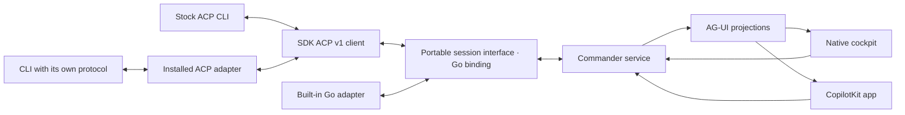

# Harness integration plan

**Release-one implementation plan · November 23, 2026**

An integration author should be able to add a CLI once and exercise it from every supported Commander console. A user should be able to tell which operations the installed harness supports and inspect all available conversation data in Pretty or Console mode.

## Decisions

| Subject | Decision | Basis |
| --- | --- | --- |
| Extension authors | The first production release supports both built-in Go adapters and independently installed executable adapters. Both must pass the same conformance tests. | Requirements interview, first answer |
| Executable distribution | Support third-party adapter catalogs in release one with version pinning, publisher verification and an update workflow. A user can also register an installed executable. | Requirements interview, installation scope |
| Distribution formats | Install verified platform binaries, npm packages and Python packages from ACP-format catalogs. | Requirements interview, package coverage |
| Independent onboarding | Beyond Claude and Codex, require two real CLI proofs, one stock ACP executable and one CLI served by a separately shipped translation adapter. Proposed targets are Gemini CLI and Pi in RPC mode, respectively. | Requirements interview, release gates. Target selection is an engineering proposal. |
| Publisher trust | Adding a catalog enables discovery. On first install from a new publisher, the user chooses whether to trust that verified publisher identity. Verify the selected release artifact before installation. | Requirements interview, publisher trust |
| Adapter updates | Notify the user of a verified update. The user applies it or rolls back explicitly. Sessions already running finish on the exact version they started with. | Requirements interview, update policy |
| Interoperability | Prefer published standards for the external adapter contract. A third-party author should be able to reuse the adapter with another conforming client. | Requirements interview, stated design priority |
| Default provider connection | Use stable Agent Client Protocol v1. Try a harness's native endpoint first. Evaluate the upstream Claude and Codex adapters using local sessions before expanding to SSH. | [MVP provider connection](../MVP-PLAN.md) |
| Reusable SDK | Develop `agent-acp` in its own repository. Generate language packages from a shared session schema and run the same contract fixtures in each language. The SDK owns portable handles, capabilities, typed observations and provider-specific translation. Commander pins a release, binds workers to handles, authorizes operations and projects events to AG-UI. | [Common harness SDK](../MVP-PLAN.md#common-harness-sdk) |
| Commands and ownership | The Go service validates the actor, worker, control generation and request. It owns acceptance and delivery receipts. MCP exposes scoped coordination operations. | [Current pattern decisions](PATTERN-DECISIONS.md) |
| History | The harness owns transcript contents and retention. Commander keeps session references and operation evidence and uses bounded live projections. Read history through ACP replay and supported provider-native lookup. A missing interval has an explicit status. | [MVP history policy](../MVP-PLAN.md) |
| Native transcript fallback | When ACP and documented APIs omit recorded data, the adapter may use a read-only, version-tested reader restricted to the selected provider session. An unrecognized format produces an explicit gap in both console modes. | Requirements interview, transcript recovery |
| CopilotKit release | Ship an embeddable integration and a working reference console. A separate CopilotKit app can send a prompt, inspect a tool result and answer a pending request with either Claude or Codex. Swift remains the primary Commander cockpit. | Requirements interview, CopilotKit delivery |
| Remote embedding | Support an independently hosted CopilotKit backend connecting remotely to Commander with authenticated access. This expands the existing local client deployment scope. A remote app connection and a remote worker host are separate concerns. | Requirements interview, embedding deployment |
| Network routes | Release one supports both direct HTTPS and an outbound relay connection from the developer's host. Both enter the same Commander authorization path. | Requirements interview, gateway topology |
| Relay editions | Ship a self-hostable relay and operate an official managed relay service at launch. Both forward requests only while Commander is connected. If the host is offline, report it immediately. The app may retry an identified operation after reconnect. | Requirements interview, relay operation |
| Relay data handling | Both relay editions may terminate TLS and see application payloads in process memory for routing. Exclude prompts, replies, tool output and attachments from persistent logs. | Requirements interview, relay privacy |
| Official service launch | Operate an invite-only production cohort with an assigned operator, monitoring, incident response and enforced capacity limits. Expand availability after measuring demand. | Requirements interview, operating commitment |
| Hosted app authority | A single developer grants each app revocable, scoped access. That app may act within its grant while the developer is offline. Worker ownership and pending approvals continue to govern each operation. | Requirements interview, app principal |
| Frontend tools | An embedding app may register a tool for a specific session. Commander authorizes the tool and correlates its result to the originating call. Support is capability-dependent. | Requirements interview, frontend tool execution |
| ACP direction | Commander acts as an ACP client when connecting to harnesses. For release one, other applications connect to Commander through its supported AG-UI/CopilotKit integration. | Requirements interview, external client access |
| Presentation | Pretty and Console must give access to the same available worker records, ordered blocks, attachments and source details. Compact views can link to the corresponding position in the full worker view. | Transcript review and console requirements |

## Starting point in this checkout

- The Go service depends on a launcher with two operations, launch and stop. The local launcher currently selects Claude. Managed workers already support follow-up delivery and interruption. The adapter migration must preserve the original conversation and the service's distinction between accepted, delivered and uncertain work. [Launcher interface](../internal/service/store.go) · [local provider](../internal/provider/local.go) · [managed worker](../internal/provider/managed_worker.go) · [control API](../internal/service/control.go)
- The Swift app consumes a workspace-wide AG-UI snapshot and delta subscription. The separate CopilotKit proof launches a fixed Claude scenario and polls the Go API. The production integration below accepts the caller's prompt, authorizes the target and correlates each interaction to its live request. [Desktop subscription](../internal/service/agui.go) · [CopilotKit proof](../poc/agui-console/README.md) · [proof adapter](../poc/agui-console/server.mjs)

## Proposed framework boundaries

| Boundary | What the framework should own | What an adapter or consumer should supply |
| --- | --- | --- |
| Registration | Resolve one installed harness by identity and version, verify compatibility, and expose negotiated capabilities. | A built-in constructor or a registered executable. An already compatible ACP executable should work from a launch profile. |
| Session | The SDK supplies portable session handles and observations. Commander binds each worker and host to a handle and validates commands, input control and request ownership. | Translate to the provider's session operations and report delivery evidence and native identifiers. |
| Observation | Normalize known events, retain source positions or references, preserve unknown fields, and distinguish an unavailable record from an empty result. | Supply ordered observations, available source detail and any verified replay or attachment access the harness supports. |
| Presentation | Translate the shared semantics into AG-UI events for clients. Preserve the workspace subscription and define the per-conversation run lifecycle. | Native clients and CopilotKit consume the same events and route actions through the service. Each frontend can choose its own presentation density. |
| Conformance | Drive the same scenarios through both adapter forms. Check required behavior and each advertised optional operation. | A way to run deterministic fixtures, followed by real-harness evidence for capabilities that depend on the installed CLI. |

### Adapter author workflow

The project's `agent-acp` SDK generates Go, TypeScript and Python clients from a versioned Protobuf session schema. Commander consumes the Go package `agentacp`. That schema is the SDK consumer contract. A third-party executable remains interoperable by speaking standard ACP v1 on its process connection. Test wire compatibility with an independent ACP client and test SDK semantics with common fixtures in each language. [Common harness SDK](../MVP-PLAN.md#common-harness-sdk)

1. **Select the boundary.** Register an existing ACP executable with its arguments, ship an executable translating the CLI's protocol to ACP, or register a built-in Go adapter constructor. Reuse the SDK's ACP client for every external executable. An adapter has no dependency on Swift, React or CopilotKit.
2. **Describe and negotiate capabilities.** The descriptor identifies the adapter and its version. The live handshake determines which operations this installed harness supports. The SDK exposes a small session interface for identity and observation, then separate capability interfaces for sending a prompt, resolving an interaction, interrupting a turn and reading history. The host checks capabilities before offering a control. A capability may become unavailable after reconnect.
3. **Translate provider facts.** Preserve session, turn, message and tool-call identity where supplied, ordered blocks, terminal outcomes, source references and unknown fields. Distinguish absent provider IDs from any local identifiers minted to track delivery. Keep stderr and unstructured output alongside structured observations. Partial and final events update the same semantic object when identity establishes the relationship.
4. **Return evidence for operations.** Match a follow-up or response to its operation and request IDs. Report accepted, delivered, completed, unsupported, requires user action or delivery unknown as appropriate. The service retains the receipt. A transport acknowledgment alone establishes only what that transport confirms.
5. **Pass the same suite and onboard.** Exercise live operation, passive history, reconnect, interleaved workers and an unavailable capability. Include a vendor-specific payload and a missing resource. Publish the executable or register the built-in creator, then run the same reference consumers. Harness selection belongs in registration and service policy.

After Claude and Codex, register a stock ACP executable using configuration alone. Independently install a second executable that translates a different CLI's native protocol into ACP. Run one conversation, inspect a tool result and exercise a supported interaction on each through the same clients. Gemini CLI on the development Mac advertises the `--acp` flag. Pi's `--mode rpc` uses its own command and event protocol, making it a candidate for the translation test. [ACP agents](https://agentclientprotocol.com/get-started/agents) · [Pi RPC protocol](https://docs.pi.dev/latest/rpc) · [AG-UI architecture](https://docs.ag-ui.com/concepts/architecture)

### Recommended external adapter contract

One executable can translate the harness's native data into stock ACP v1. For example, when native history contains a PDF and error details, the adapter can replay the tool call with its original identity, failed status, structured output and an embedded PDF or resource link. Use the same representation live when the data is available then. Commander can implement its internal adapter interface in Go. An external author can implement the wire protocol in any language. [ACP tool calls](https://agentclientprotocol.com/protocol/v1/tool-calls) · [ACP content blocks](https://agentclientprotocol.com/protocol/v1/content) · [ACP session replay](https://agentclientprotocol.com/protocol/v1/session-setup)

If an existing ACP executable omits recorded material, prefer a supported provider lookup that can establish the relationship to the specific session and tool call. Where an authorized MCP resource server already exposes a linked artifact, Commander can resolve that URI with `resources/read`. MCP defines resource retrieval. The adapter must still establish which server owns the reference and which tool call produced it. Treat a missing association or unavailable resource as such in both modes. [MCP resources](https://modelcontextprotocol.io/specification/latest/server/resources)

For an interoperability test, run the external adapter against an independent stock ACP client and the Commander conformance harness. Verify that ordinary ACP messages carry the same tool-call identity, failure details and resource content or reference in each. In Commander, follow the result through AG-UI and inspect the same details in Pretty and Console.

Exercise the native transcript fallback with two sessions in one checkout. In the supported format, recover the attachment only for the selected session and verify the source tool-call identity. Repeat with an unfamiliar format. Both modes should retain the ACP data and identify the gap in supplementary history. The source files must remain byte-for-byte intact in both tests.

## Pattern choices

Use the GoF **Adapter** to isolate each provider and the existing **Facade** for domain operations. A **Message Translator** turns provider events into shared conversation semantics and AG-UI events. A **Correlation Identifier** binds a reply to the worker's original request. The **Idempotent Receiver** prevents a second client or a retried request from repeating a resolved action. The project already uses a **Publish-Subscribe Channel** for observers and a **Message Store** for Commander-owned operation evidence. A registry can select an adapter by ID. Whether a family of related objects warrants an Abstract Factory depends on the final plugin contract.

The accompanying review assesses all 23 original GoF patterns and all 65 EIP messaging entries, with a concrete use or condition for reconsidering each. It also covers the EIP authors' separately published conversation topics. [Pattern-by-pattern review](HARNESS-PATTERN-REVIEW.md) · [GoF publisher's catalog](https://www.informit.com/store/design-patterns-elements-of-reusable-object-oriented-9780321770462) · [EIP messaging catalog](https://www.enterpriseintegrationpatterns.com/patterns/messaging/toc.html)

## Catalog compatibility

Use the published ACP registry format for discovery. Its distributions include platform binaries and package-manager references. A binary can carry a SHA-256 digest. An author name and a digest establish different facts from a verified publisher signature. For each catalog installation, the proposed local record binds catalog origin, adapter identity, resolved version, platform, artifact digest and verified publisher identity. Resolve mutable package references to immutable artifacts before activation. Installation receipts belong to the host performing the install. [Registry format](https://github.com/agentclientprotocol/registry/blob/main/FORMAT.md) · [registry schema](https://github.com/agentclientprotocol/registry/blob/main/agent.schema.json)

| Step | Required outcome |
| --- | --- |
| Discover | Display the catalog origin, adapter identity, publisher and available versions. Two catalogs can contain the same display name. Keep their records attributable to their origins. |
| Verify and stage | Bind the release to an independently verifiable publisher identity and the bytes selected for this host. For binaries, verify the platform archive. For npm or Python, stage a reproducible dependency set with pinned versions and integrity hashes in an isolated location. A release with insufficient verification evidence is ineligible for catalog installation. |
| Activate | On first install, obtain the user's trust decision for the verified publisher. Validate protocol compatibility and atomically switch the active pin. A failed install leaves the last usable version available. |
| Update and roll back | Notify about a verified candidate. Activation requires user action. An active worker keeps its immutable installation reference until the session finishes. Retain the prior verified installation for rollback and release idle versions only after checking active references. |

## AG-UI and CopilotKit implementation

- Keep the owner-scoped workspace subscription for the native wall. Provide a separate per-conversation AG-UI run endpoint for embedding. Validate the incoming thread, run and actor binding. Route a new prompt, continuation or identified reply through the existing command API. A subscription or reconnect is observational and cannot implicitly submit the prompt again.
- Translate SDK updates into AG-UI run, text, tool and state events. Preserve provider status, attachments and source references that require a details view. The native and CopilotKit projections use the same worker and item identities. An independently hosted backend receives only the streams and source details authorized for its principal.
- For a frontend tool, bind the app, session, advertised schema and tool call. Use a harness-supported tool bridge, such as a session-scoped MCP server supplied during ACP session setup, where the adapter can verify support. Relay the invocation to the registered app through AG-UI and validate the result before forwarding it to the awaiting call. On unsupported harnesses report that capability explicitly. [AG-UI tool model](https://docs.ag-ui.com/concepts/tools) · [ACP session setup](https://agentclientprotocol.com/protocol/v1/session-setup)
- Give the remote gateway an authenticated service entry point that preserves the application identity through authorization. Never forward an unauthenticated network request as the local socket owner. Test rejection of a missing grant, a mismatched worker binding and an attempt to read the private workspace-wide feed.

### Remote application grants

Use standard OAuth mechanisms for a user-authorized app and a maintained implementation. Scope a grant to the owning developer, calling application, permitted projects or sessions and allowed operations. Separate observing a session, reading its source attachments, sending prompts, answering requests and registering frontend tools. Persist grant and revocation state with the service. Bind access tokens to the intended gateway audience, and recheck the grant and worker ownership when executing an action. Use the same grant, request ID and result semantics through direct HTTPS and the relay. [OAuth security best current practice](https://www.rfc-editor.org/rfc/rfc9700.html)

Exercise a hosted app with the developer disconnected and the host still available. Revoke its grant while it watches a session, then attempt a fresh subscription, an attachment read and a pending reply. Reject the revoked actions, stop future delivery on its stream and preserve any independently accepted operation receipt. A second app with its own grant remains unaffected.

### Relay deployment and operations

Use the same forwarding implementation and interop tests for self-hosted and official deployments. The host connector initiates an authenticated outbound connection. Authenticate both transport legs, bind the connector to the intended Commander instance and preserve the calling app's identity for Commander's authorization check. TLS may terminate at the relay. Forward payloads in memory, bound buffering and close or resynchronize stalled streams. A disconnected host produces an immediate unavailable outcome. If forwarding may already have happened, return the operation ID for receipt lookup and reconciliation.

Limit persistent operational telemetry to an explicit set of fields such as connection state, elapsed time, byte count and error category. Test with synthetic markers in prompts, approval replies, tool output and attachment bytes. Verify that the markers stay out of application logs, reverse-proxy logs, traces and error reporting during success, malformed requests, overload and disconnects.

Before admitting the first official cohort, assign the operator and incident contact, publish the self-host deployment and upgrade instructions, set invitation and revocation procedures, and load-test explicit bounds on connections, throughput and in-flight buffers. Exercise alerts, rollback and host reconnection. Test that one developer's connector cannot receive another's traffic. Use utilization, failure and support data from the invited cohort to decide when to expand.

## Proposed implementation sequence

| Increment | Deliverable | Exit check |
| --- | --- | --- |
| 1. Portable session contract | In `agent-acp`, define session references, negotiated capabilities, ordered observations, request IDs and delivery outcomes in the shared schema. Generate the language clients from it. Publish a test driver that runs identical scenarios against a registered Go adapter or an installed ACP executable. | Both adapter forms pass a deterministic prompt, tool result, named request and reply. An unadvertised capability returns its defined outcome. |
| 2. Real local sessions | Connect the Claude and Codex ACP adapters through the shared transport. Commander binds each provider session to its worker and calls the SDK through the existing command API. | Repeat the same user workflow against each real CLI, including follow-up, targeted interrupt and recovery. Reconnecting restores the same worker and pending request. |
| 3. History and console fidelity | Add passive history reads, opaque pagination and version-tested source readers. Project observations for the native Pretty and Console modes and preserve native-only fields, multipart results and missing-data diagnostics. | Replay the transcript coverage fixtures and compare reachable record identities, fields and media in both modes. Verify isolation with two sessions in one directory. |
| 4. Embeddable AG-UI integration | Give CopilotKit a per-conversation run endpoint, correlated actions and a documented connection example. Build the reference console on the same public integration available to another app. | A separate CopilotKit app and the reference console each send a developer-supplied prompt, inspect a tool result and resolve an identified pending request. Run the workflow on Claude and Codex. |
| 5. Hosted app and direct gateway | Implement app authorization, scoped credential issuance and revocation. Expose the per-conversation integration through authenticated HTTPS. Register and resolve one app-defined tool where supported. | A separately hosted backend completes the reference workflow with the developer offline. A revoked app loses ongoing access. A tool result from a different app or session is rejected. |
| 6. Outbound relay | Implement the host connector and relay route to the same gateway. Ship the self-hosted distribution and prepare the official service for launch. Preserve app identity, stream cancellation, limits and operation IDs across disconnects. | Run the same interop suite on both relay editions. Disconnect before dispatch and verify an immediate unavailable result. Disconnect after possible dispatch, recover the operation receipt or report delivery uncertainty, and prevent duplicate execution. |
| 7. Catalogs and version management | Read third-party ACP catalogs. Verify publishers and artifacts for platform binaries, npm and Python packages. Stage installations, pin versions, notify about upgrades and support rollback. | Each package family passes install, verification failure, update and rollback tests. Two concurrent workers complete on their pinned versions. |
| 8. Independent onboarding and release | Package the SDK, publish compatibility and conformance instructions, and onboard a stock ACP CLI and a CLI requiring a separately shipped translator. | Both work in the existing clients through registration or independent adapter installation. Pin the tested SDK release in Commander. Verify the native wall, focused console and PiP with Computer Use and the approved designs. |

## Behaviors the implementation must demonstrate

Use the November 23, 2026 local transcript inventory to build a synthetic fixture manifest. The audit covered 358,936 Codex rollout records and 174,972 Claude journal records plus separate live CLI captures. Keep saved journals, ACP session updates, vendor stdout and AG-UI projections as distinct formats. Include multipart tool errors, intermediate updates, repeated IDs across workers, provider-visible summaries, resource links, opaque payloads and unfamiliar fields inside known messages. For each fixture, record how a user can reach each available field in both modes. Include the distinction between a field omitted by the provider and one Commander failed to project.

- The SDK example opens a session, sends a literal prompt, observes a request, answers by request ID, interrupts the intended turn and reads history after reconnect. Run the same example with Claude and Codex.
- Opening history preserves active input ownership. Historical approvals are display-only. A repeated command after ambiguous delivery recovers its receipt or reports uncertainty. Explicit handback governs Commander input ownership.
- Reconnect to two managed workers in one checkout and retain their separate identities. Adopt a session only with verified provider identity. A provider-owned child can remain observational when its control endpoint is unavailable.
- Replay an interleaved stream with repeated text, an orphan result, a native-only field, a linked attachment and an expired source. Both modes keep the source attribution and show a gap where recovery is impossible.
- Submit two different answers for the same pending request from authorized surfaces. Accept one, return a conflict for the other, and let that authorized caller read the winning resolution. Repeating the accepted answer returns the recorded result.
- Load a third-party catalog, select a verified publisher for the first time and install a pinned release. Replace the artifact at the same advertised version and verify that a digest mismatch blocks activation. Apply an update while a worker is using the old version. Start a second worker on the updated pin, roll back, and verify that each running worker retains its original executable and new workers use the selected pin.
- Configure the reference CopilotKit console against the service using the documented integration. Run a developer-supplied prompt, inspect the resulting tool call and result, then answer a pending request by ID. Repeat against the second harness using the same client code. Exercise the integration from an independent consumer to detect accidental dependencies on the reference console.
- Register an app-defined document picker for session A. Advertise it only when the harness can invoke it. Return the user's selection to the originating call, exercise a cancellation and a repeated result, and show that session B cannot invoke or complete A's call. Treat disconnection after a side effect as uncertain until the originating app or provider supplies evidence.

## Migration and verification

1. Land shared synthetic protocol fixtures and the SDK exercise before switching production sessions. Keep the existing service command endpoints and workspace subscription usable by the current app. Existing workers with plain text remain readable in both modes.
2. Select the new provider path when creating a session. Keep its provider binding for that session's lifetime. Run Claude and Codex in an isolated local service, compare live and reloaded observations, and demonstrate targeted control during a two-worker run.
3. Verify the catalog installer once for each supported distribution family. Exercise clean install, untrusted publisher, digest mismatch, incompatible release, interrupted staging, user-approved update, two active versions and rollback.
4. Exercise an output-heavy worker alongside a pending approval in a different worker. Use the project's 30-pane scenario, record approval latency, memory and reconnect behavior, and compare against a measured baseline on the test Mac. Check that large attachment retrieval stays outside the shared workspace snapshot. [Stream recovery decisions](PATTERN-DECISIONS.md)
5. Fable owns the native Swift components. Codex independently exercises both display modes through Computer Use and compares the wall, focused worker and PiP to the approved screenshots. Exercise the reference CopilotKit console through its public connection. Keep capture evidence linked to the versions tested.
6. Promote the SDK-backed path after the existing Claude workflow, both primary harnesses, both independent onboarding cases and the client parity checks pass. Roll back new-session selection independently of running workers. Resolve an in-flight request using its recorded binding and delivery evidence before retrying it.
