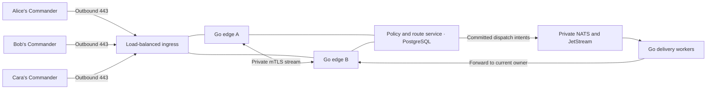

# Multiplayer relay architecture

**Status** — Proposed design for the Go relay. The existing Go connector authenticates an outbound TLS tunnel and serves the hosted gateway over HTTP/2. Its route table is local to one relay process, its edge can read forwarded content, and it has no delivery queue. Its scoped worker access, stream limits and recoverable operation receipts are the starting point. [Existing relay](RELAY-DEPLOYMENT.md) · [Connector](../internal/relay/connection.go) · [Router](../internal/relay/relay.go)

The unit of routing is a **device session**. The unit of paid work is a **logical agent operation**. A group names a set of recipients. Its members can be connected to different edges, own several devices, and make independent sharing decisions.

## One public endpoint, many relay instances



1. **Accept anywhere.** An L4 balancer assigns new outbound connections to healthy Go edges using least connections or measured capacity. Each open socket stays on its accepting edge for its lifetime. Device identity and authorization survive a reconnect to any healthy edge. No user-affinity cookie is required.
2. **Register a single owner.** After proof of device-key possession, the route service locks the device's PostgreSQL row, increments a durable generation, and binds the edge and a fresh session ID with a lease deadline. The device installs the generation before the route becomes ready. Renewal, readiness and removal require the matching generation and session. Retain the counter across lease expiry. JetStream KV can mirror active routes with a TTL, and Core NATS can announce changes. A stale cache entry can cause an extra lookup. Only the authoritative row can grant ownership. [Fencing Token](../.context/design-patterns/fencing-token.md) · [NATS KV](https://docs.nats.io/learn/key-value/)
3. **Forward to the owner.** Stream locally when the recipient's session is on this edge. Otherwise send a bounded, mutually authenticated HTTP/2 stream directly to the owning edge. The owner verifies the addressed device, session and generation. A stale route triggers a fresh lookup. A lost acknowledgement after bytes were forwarded triggers a receipt lookup using the original operation ID. A device accepts frames only on its current authenticated session. [Dynamic Router](../.context/design-patterns/dynamic-router.md) · [Correlation Identifier](../.context/design-patterns/correlation-identifier.md)
4. **Drain and rebalance.** A draining edge leaves the balancer's healthy set first. It finishes bounded in-flight streams and asks devices to reconnect with jitter. Abrupt loss expires leases. New replicas absorb new or reconnecting sockets immediately. Long-lived hot connections need stream limits, byte quotas and selective draining as well as connection balancing. A blocked recipient consumes only its allocated buffer, slot and deadline.

Use a versioned, client-initiated, full-duplex session over standard HTTPS on 443 for the new protocol. Client and edge can exchange logical requests on this session. Test idle timeouts and buffering through actual corporate proxies. During migration, keep the existing listener contracts separate. For example, a distinct connector hostname can route TLS via SNI while the hosted API and existing custom ALPN continue to serve their current clients. Headscale is an optional private transport to the same authorized service.

## One submission, independent recipients

| Mode | Expansion and acceptance | Budget effect |
| --- | --- | --- |
| Message the room | Freeze eligible inbox recipients and the membership revision. Each receives its own encrypted delivery. | Delivery alone starts no model turn. |
| Ask everyone | Create one child per distinct target agent. Track received, accepted, declined, expired, uncertain and completed outcomes independently. | Reserve each accepted child against its payer and the parent cap. |
| Ask one or one per capability | Send cheap offers to eligible peers. An atomic claim for the parent and capability slot selects one accepting worker. | Only a successful claim can reserve a paid execution. |

Start with flat groups. Resolve sender permissions, membership, each recipient's inbound sharing policy, blocks and verified device keys into a versioned audience. If nested groups are introduced, snapshot revisions for every group traversed, reject cycles and deduplicate overlapping memberships. In one transaction the service validates the snapshot, size and fanout limits, then records the parent and its authorized children. A stale roster requires a fresh resolution before acceptance. Retrying an accepted parent returns its original roster and receipts. A removal or revocation closes still-pending access.

For a room message or an ask-everyone request, the sender seals content to the authorized recipients. For a volunteer request, it first seals a minimal offer containing the capability, deadline and spend ceiling. Successful claims are unique on `(parent, slot)`. Only then does the sender seal the task for the winning device. If the sender disconnects, the slot waits for its return until a bounded deadline. Slot reassignment advances the claim generation and is allowed only before execution begins.

Each durable child is unique on `(requester, parent, slot, target agent)`. A broadcast uses one logical slot per request. Two distinct capability slots may be claimed by the same agent when the parent allows it. Bind a child's immutable content digest, expiry, kind, audience and payer. Transport attempts get separate IDs. Multiple devices can display an inbox notification, while each paid child has one designated executor. Limit concurrent children, bytes, spend and delegation depth per parent and payer. Schedule bounded batches fairly across senders and parents so a large group leaves capacity for unrelated work. [Recipient List](../.context/design-patterns/recipient-list.md) · [Scatter-Gather](../.context/design-patterns/scatter-gather.md) · [Aggregator](../.context/design-patterns/aggregator.md)

When offline delivery is permitted, write the sealed child and its [Transactional Outbox](../.context/design-patterns/transactional-outbox.md) intent with the acceptance record. A publisher waits for JetStream acknowledgement before marking the outbox item published. Interchangeable dispatchers share a pull consumer and claim one **already addressed child** at a time. They record an outcome or bounded retry before acknowledging. Replaying the same child can recover a receipt. Live-only streams keep only the permitted receipt metadata and report interruption. [Competing Consumers](../.context/design-patterns/competing-consumers.md) · [Idempotent Receiver](../.context/design-patterns/idempotent-receiver.md) · [JetStream delivery semantics](https://docs.nats.io/concepts/jetstream)

### Online workspace handoffs

Offer a durable workspace destination with an owner-selected coordinator run as its local anchor. The destination is addressed to the owner's device and is discoverable and executable only by its current workspace members who are paired friends and hold the corresponding grants. The owner can approve each handoff or authorize bounded automatic admission through the normal grant. A waiting handoff survives the anchor run ending. Automatic startup of a managed replacement coordinator is an explicit workspace inbox setting and defaults off. When an eligible coordinator is already idle, the service uses its existing managed follow-up queue. It leaves busy and developer-controlled turns alone.

The existing operation ID binds the encrypted relay child, owner-local durable inbox record, and Commander reservation. A repeat delivers the original receipt. The relay charges the original allowance at the delivery claim and rechecks the addressed lease, original grant, friendship, and membership when authorizing scheduling. A revocation ordered before this authorization prevents a new reservation. An admitted turn uses the normal local control generation and deadline guards; a change of developer control can cancel a queued turn. A device displaced between claim and its receipt can recover its unfinished workspace delivery without charging an additional use. Older action types retain their uncertainty semantics.

The initiating receipt indicates **Delivered** only after the device has durably recorded the handoff. **Accepted** marks the exact coordinator claiming it, and **Verified** requires operation-specific evidence. The first supported evidence verifies the bound completed turn's locally observed checkout HEAD against the optional expected revision. A successful turn without the evidence has an explicit unverified result. Read later observations with the existing signed status/result actions, using the stable handoff ID in their correlation field. The sender retains all valid timestamps across retries and restart.

The first cut keeps the existing authenticated HTTPS long poll, addressed JetStream wakeups and PostgreSQL outbox. A workspace recipient uses a one-second authoritative fallback when an ingress selects a different edge for its long poll. The sender's observed delivery acknowledgment p95 target is two seconds when both devices are online. A two-device fixture runs real TLS clients on independent Go edges backed by PostgreSQL and JetStream, and reports the distribution and failures through the normal tray send operation. That test substitutes the recipient's local Commander Unix socket, which stays off the delivery critical path. Separate owner-service tests exercise actual coordinator reservation, claim, expiry and verification. The proposed full-duplex transport and broadened fan-out remain independent future work.

Upgrade the relay first to add workspace metadata and admission checks. Existing legacy and coordinator-inbox resources retain their original contracts. Then upgrade the devices and owner service and enroll a new workspace resource. An older local owner service leaves the durable inbox queued until the service understands the reservation endpoint.

## Identity, contents and authority

| Boundary | Decision and enforcement |
| --- | --- |
| Tray to relay | Browser sign-in with OIDC authorization code and PKCE binds a user to device keys held in the OS keystore. Issue a short-lived device-bound credential. Advertise authorized presence once the tunnel is ready. Revoke a device independently of the user's other devices. [Native app authorization](https://www.rfc-editor.org/rfc/rfc8252.html) |
| Sender to recipient | Use a reviewed end-to-end encryption protocol with authenticated device identities, key-change verification and rotation. Bind recipient, operation ID and expiry to the authenticated envelope. The relay handles routing metadata and opaque payloads. Identity enrollment and key verification are trust boundaries. Purge expired ciphertext from queues and outbox storage. |
| Group to local agent | Friendship and group membership govern discovery and delivery. The receiver decrypts the request, verifies the sender, target, operation and current owner grant, then maps it to a narrowly scoped local worker. Apply workspace isolation at the executor. Raw tmux control and model credentials stay with the owner. |
| Payer to execution | The executor requests a claim from the policy service. One database transaction verifies current grants, blocks, expiry, device generation, payer limits, parent budget and concurrency before issuing a bounded claim. The executor revalidates the actual requested model and limits. Owner-local credentials or the payer's own metered proxy fund the turn. Settlement is keyed by child. An ambiguous provider outcome keeps its reservation until reconciled. |
| Service to broker | Core NATS handles transient internal notifications. JetStream retains chosen durable records. Use workload identities, mTLS and scoped publish/subscribe permissions. An auth callout can translate service roles into broker permissions. Devices never receive broker credentials. The policy service owns durable relationships, grants, revocations, claims and the ledger in PostgreSQL. [NATS Auth Callout](https://docs.nats.io/learn/security/auth-callout) |

Group revocation is checked again on delivery and execution. Define the claim commit as the admission point for a paid run. Cancellation after admission requests a stop and reconciles work already performed. If policy or the authoritative ledger is unavailable, defer paid admissions. An authorized workroom can still display previously delivered local history under its retention policy.

The pilot debits the allowance and claims the child in the same transaction. When accepted work loses its allowance before claim, the relay records a terminal `denied` receipt without an execution result. The [Idempotent Receiver](../.context/design-patterns/idempotent-receiver.md) returns that receipt on retry, even after the owner renews the allowance. An explicit revocation, such as removing an active capability, records `revoked` on still-pending children.

Device revocation clears the credential and fences its lease in one transaction. It withdraws that device's resource actions, marks pending work in either direction `revoked`, and marks work already claimed by the revoked executor `uncertain`. New submissions check both device enrollments before recording a child. A receiver can move past an old inbox entry whose sender key is no longer available while retaining its lease for the rest of the batch. [Fencing Token](../.context/design-patterns/fencing-token.md)

The device uses a [Message Translator](../.context/design-patterns/message-translator.md) to turn local action errors into a fixed set of recovery codes inside the signed result. This gives the initiating coordinator enough information to reconcile a stale revision or an uncertain provider outcome while keeping command output, checkout paths and credential details on the owner's device.

Each registered [Command](../.context/design-patterns/command.md) carries its payload contract alongside its executor. Coordinator discovery attaches locally compiled descriptions and JSON Schemas for the subset authorized by the relay, with one contract per action across all discovered resources. The receiver still validates each request and the current grant before execution.

## Extension contracts in Go

Keep edge, dispatcher and control-plane roles independently scalable. Start with Go packages and explicit constructor wiring. Define small interfaces at the consuming package where an alternative implementation is expected. The core owns enrollment, grants, quotas, validation, idempotency and receipts. A provider can select among eligible targets or deliver a sealed envelope through an approved transport. It receives only the data required for that operation.

| Extension point | Inputs and outputs | Pattern and first implementation |
| --- | --- | --- |
| Recipient selection | Frozen eligible targets, requested capabilities and mode → proposed target IDs or claim slots. The core verifies the returned subset and deduplicates. | [Strategy](../.context/design-patterns/strategy.md) for all, one or one per capability. |
| Device transport | Verified route, immutable sealed child and deadline → accepted, unavailable, stale route, or uncertain attempt. | [Adapter](../.context/design-patterns/adapter.md) for a live tunnel. A private overlay can implement the same interface. |
| Durable delivery | Publish one child, pull bounded batches, acknowledge or retry by ID. Declare retention and redelivery capabilities. | [Messaging Gateway](../.context/design-patterns/messaging-gateway.md) with a JetStream adapter. |
| Operation handlers | At the relay, authenticated routing fields → delivery decision. At the recipient, decrypted command and sender identity → locally authorized action or rejection. | [Message Dispatcher](../.context/design-patterns/message-dispatcher.md) selects a handler inside its trust boundary. |
| Lifecycle observers | Redacted outcome events → independent notifications, metrics or projections. | [Publish-Subscribe Channel](../.context/design-patterns/publish-subscribe-channel.md). Observers can fall behind and recover separately. |

A new capability-matching feature illustrates the boundary. Register a named strategy at startup, pass it only the eligible agent advertisements and return a set of proposed claim slots. Reuse the existing grant, budget and delivery paths. Startup rejects duplicate names and incompatible major versions. Unknown required features yield a typed rejection that the sender can display. Pin the selected version on an accepted operation so retries preserve its meaning.

For example, these proposed interfaces give selection and transport different authority. The dispatcher constructs a `SealedChild` only after validation. An implementation must distinguish failure before forwarding from delivery with an unknown outcome.

```go
type RecipientSelector interface {
    Select(ctx context.Context, request SelectionRequest, eligible []Candidate) ([]SlotProposal, error)
}

type DeviceTransport interface {
    Deliver(ctx context.Context, owner DeviceRoute, child SealedChild) (AttemptReceipt, error)
}
```

Compile trusted first-party implementations into the Go binary. If third-party extensions become necessary, run them out of process behind an authenticated, version-negotiated RPC adapter with deadlines, size limits and capability-scoped credentials. Arbitrary in-process code has the relay's privileges. An extension conformance suite should exercise cancellation, duplicate calls, unavailable dependencies, stale route handling and attempts to widen the recipient set. [Go plugin package limitations](https://pkg.go.dev/plugin)

## First vertical slice and acceptance checks

Start with authenticated tray sessions on two Go edges and an unbilled group message. Add durable offline delivery next, then sponsored worker execution. Keep the existing hosted protocol available through these increments.

| Exercise | Observable result |
| --- | --- |
| Place three recipients on different edges and submit one parent. | Three distinct child receipts. One slow recipient leaves the other two streams responsive. |
| Start a large group request to saturated devices, then send a small request from another user. | The small request can claim capacity and complete while the large request is still draining. |
| Reconnect a target on edge B, then replay edge A's delayed disconnect and dispatch. | B retains ownership, A's stale generation is rejected, and the operation remains recoverable by ID. |
| Crash after PostgreSQL commit or after broker acceptance but before recording the publish acknowledgement. | The outbox recovers the child. Redelivery returns the existing recipient receipt. |
| Remove a member while offline, add a new member, then retry the parent. | The removed member's pending delivery is denied. The new member is absent from the recorded recipients. |
| Race three workers for one paid capability slot and interrupt the winning provider call. | One reservation and one executor claim. The receipt reports uncertainty until the original outcome is recovered. |
| Drain an edge under load and revoke one device. | Authorized devices reconnect with jitter to healthy edges. The revoked device cannot renew or resume. |

Measure active sockets, stream and byte saturation, per-child queue age, stale-route retries and receipt recovery. Load-test long-lived sessions, skewed group sizes and hot destinations. Publish measured limits when an implementation and representative workload exist.
