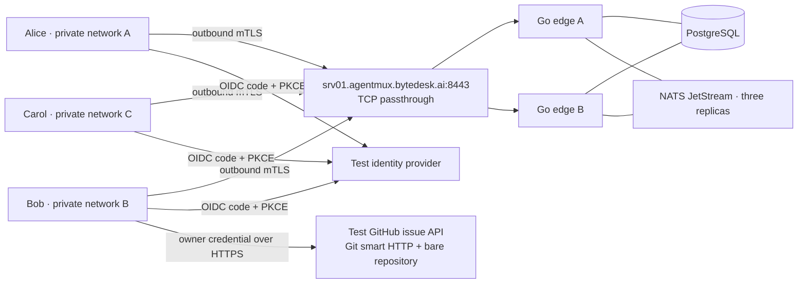
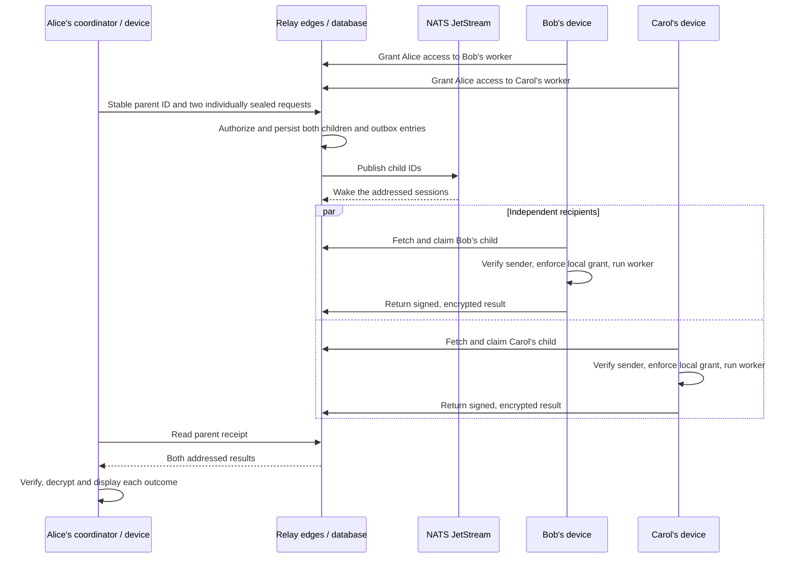

# Docker multiplayer rehearsal

Run `make test-multiplayer-docker` from the repository root. The target allocates a fresh Compose project, creates disposable identities and certificates, checks failover, runs the collaboration scenario and tears the project down. It requires Docker Compose v2 with support for `!reset`, Python 3, OpenSSL and the Go version in `multiplayer/go.mod`. The first build may need internet access to fetch base images and Go modules. During the exercise all five Docker networks are internal and the project publishes zero host ports.

## Verified on November 23, 2026

| Exercise | Observed result |
| --- | --- |
| Identity and friendship | Alice, Bob and Carol each signed in. Presence became visible after acceptance. Each owner granted access separately. |
| One-to-many work | Alice sent one request to Bob’s and Carol’s workers. Retrying returned the original child receipts and each worker ran once. The real `agentctl mcp` process discovered both resources and read the same results. |
| Coordinator and repository collaboration | Alice and Bob exchanged addressed messages. Alice read issue #1, created commit `c6a4f911c0d6` on Bob’s `commander-share/bob-repo` branch, pushed it, posted one comment and closed the issue. The remote bare repository reported that revision. Carol received a separate read-only grant and saw that same commit. |
| Offline and access changes | Work for Bob stayed queued while his container was stopped. Carol’s worker remained available. After restarting, Bob received the message once. A spent `git.head` allowance, revoked grant, and removed friendship each denied the corresponding new work. Re-friending required fresh grants. |
| Network and failover | All three network namespaces reached the ingress using TLS 1.3 with a device certificate. Direct paths to other participants and the private backbone were blocked. After stopping the JetStream leader, `nats-b` acknowledged sequence 3 and all three replicas subsequently caught up. With `edge-a` stopped, all three participants received HTTP 204 through `edge-b`. |
| Relay state and teardown | PostgreSQL held **16 completed deliveries**, each with a compact encrypted request and result. The run removed its containers, probe helpers, networks, volumes and generated credentials. |

This was a single-host exercise. The public Google sign-in, two physical Macs across the internet, and live GitHub authorization still need a live pilot. [Rehearsal commands and prerequisites](../../../multiplayer/deploy/rehearsal/README.md)

A fresh run after the Go service startup changes rebuilt `agentctl`, completed the same 16 deliveries and verified remote commit `e75461e1f113b37736f3560a041a14c9358a7374`. This time `nats-c` was the stopped leader. The run again removed all project resources.

After adding public deployment configuration, a fresh run verified remote commit `a08e4ea44d3a` and completed all 16 encrypted deliveries. `nats-b` acknowledged sequence 3 after `nats-a` stopped. All three replicas were current by sequence 5. The participants passed the relay-edge outage check and the run exited successfully. Independently, production Compose rendered the public configuration with TCP 443 on the ingress and no published ports on the database or brokers. Certificate regression cases covered an untrusted chain, a mismatched key, a wrong hostname and a legacy certificate with only a Common Name.

The Google enrollment regression used locally signed RS256 tokens and disposable PostgreSQL. Both documented Google issuer spellings selected one account. Boolean and quoted verified-email values admitted an invited identity, and unverified email, malformed claims, and an unrelated issuer were refused. Devices already registered under the older issuer spelling retained their account IDs. A fresh Docker run after the change completed all 16 deliveries, recovered from broker and edge loss, and confirmed pushed fixture commit `17dfa2f3a755`. The rehearsal waits for both edges to return HTTP 204 over mutual TLS before running the failover checks. [Google OIDC claims](https://developers.google.com/identity/openid-connect/openid-connect#an-id-tokens-payload)

The grant-race Docker run queued two GitHub comments while the owner was offline and only one use remained. After reconnect, the fixture received exactly one of those comments. The second returned `denied` without an execution result. Renewing the grant and retrying the original submission returned the same denial. The relay held 18 encrypted requests and 17 encrypted results. The run verified pushed revision `5e45879c8acd`, a new JetStream leader, and device-authenticated HTTPS with one relay edge stopped. The PostgreSQL race suite also verified that an expired grant settles an unclaimed receipt and a refused claim leaves the usage ledger unchanged.

The receipt recovery run verified `stale_revision` on a stale commit, read back the current branch, and pushed the expected revision `268976f52b3d`. A fixture wrote a GitHub comment and then returned HTTP 502. The initiating coordinator received `outcome_uncertain` without the provider's error body. Resubmitting the original ID returned the same receipt and the comment count proved no duplicate write. The run stored 21 encrypted requests, 20 encrypted results and one relay denial without a result. It also repeated the broker and edge failover checks.

The MCP contract run found all eight granted schemas through the shipped `agentctl mcp` entry point. It submitted the repository commit through MCP, pushed revision `542d0d4dcf5a`, and read the signed stale and uncertain receipts through the same MCP tools. A read-only peer received the `git.head` contract alone. A repeated action across two workers had one contract, and renewing one grant after re-friending exposed only that action on the shared repository.

The device revocation test used two relay edges and two keys per account. Revoking one sender canceled its queued child while its sibling's next submission reached execution claim. Revoking an executor removed its lease and resource actions, canceled its pending work, and recorded `uncertain` for its claimed work. The remaining executor renewed its lease. The stale inbox regression also checked that a missing sender key preserves the lease while a directory outage is surfaced as an error.

The production Linux x86-64 image ran both edges against Google's public OIDC discovery endpoint with the standard container trust store. The local ingress published a randomly assigned loopback port. Each edge returned HTTP 204 over mutual TLS while the other edge was stopped. The ingress rejected a client that supplied no device certificate. The run used disposable PostgreSQL and JetStream state and cleaned up its containers, networks, and volumes. This exercise verified issuer discovery and production startup. Browser consent and the authorization-code exchange require the live Desktop OAuth registration. [Google discovery metadata](https://accounts.google.com/.well-known/openid-configuration)

Reloading `commander-relay-pilot-linux-amd64.tar.gz` returned the exact tested platform image manifest, `sha256:69683b16f26a82e9f7265f472a90ecd41a5948a9e0de48e15c552382638b1eb1`. Archive SHA-256 `df1865959dea575ce48e0d582a194062706899f6710c0cd4d79db8b3b57591e7`. [Deployment instructions](../../../multiplayer/deploy/README.md#start-the-relay)

The signed macOS helper made two TLS 1.3 requests to a disposable loopback relay, restarting with the same local configuration between requests. The relay verified that both processes presented the same device public key. The helper kept the private key in macOS Keychain during the test, and teardown removed the isolated Keychain item. The loopback relay refused enrollment after observing the certificate, so this check required no provider account or browser session.

The macOS restart regression enrolled a device using the local OIDC fixture, accepted a friend on the other relay edge, and received a one-use worker grant. The test stopped the first macOS process, advanced the locally stored session expiry, and launched a new process using the same Keychain item. The relay renewed the same device identity, advanced its lease generation, and rotated the access and refresh credentials. The original friend and the scoped grant were still present. The test removed its Keychain item, test schema, broker, and device processes. [Test source](../../../multiplayer/internal/device/keychain_acceptance_darwin_test.go)

The relay and issuer fixtures now use different test roots. The race suite passed enrollment over mutual TLS across two edges and the macOS Keychain restart with that separation. The command transport successfully reached a private issuer without presenting a relay certificate. The extracted production helper refused invalid explicit issuer trust and cleaned up its temporary socket. The OIDC test uses a simulated browser, and the existing native panel captures use a scripted helper. [Private issuer configuration](../../../multiplayer/deploy/README.md#prepare-the-host)

`make pilot-macos` rebuilt the universal ZIP with `arm64` and `x86_64` slices in Agent Commander, `agentctl`, and `commander-network`. The extracted bundle passed strict signature verification for both architectures. Both Go helpers ran on Apple silicon, and the extracted device helper repeated the Keychain identity check across two launches. Intel verification covered the compiled slices and signatures. Local ZIP SHA-256 `0ac064d2c60a87c55d77a573c34858f373fe5731f982b187608cd1a0a36a6b2d`.

macOS distribution assessment rejected the local ZIP's ad hoc signature and reported a missing notarization ticket. The distribution build requires a Developer ID Application identity and a notarization profile. The build Mac had no such signing identity, so Apple notarization remains unverified. [macOS packaging instructions](../../MULTIPLAYER-PILOT.md#build-the-universal-macos-archive)

The Go login test confirmed that the Google path requests an account chooser, explains a refused enrollment, and permits a successful retry against the fixture issuer. The Swift tests confirmed that the refusal keeps the browser sign-in action available, including after the tray panel reopens. [Google account selection](https://developers.google.com/identity/openid-connect/openid-connect#authenticationuriparameters)

## November 24 readiness audit

The installed design-patterns 0.2.1 scan included 297 source files and returned 30 candidates across 18 patterns. It traced the service Facade from the registered create-run callback to run-state persistence and the launcher interface. The marketplace Facade, command and profile suites passed 25 tests, including renamed collaborators and unrelated callback cases. [Callback registration](../../../internal/service/api.go#L134) · [State and launch](../../../internal/service/api.go#L415) · [Launcher boundary](../../../internal/service/store.go#L398)

The 48-file relay scan returned a Publish-Subscribe Channel candidate. Source review confirmed that each edge subscribes to its own wakeup subject and the dispatcher publishes to the routed edge. The shared JetStream pull consumer, atomic outbox insert and lease generation fence required source review. [Dispatch](../../../multiplayer/internal/dispatch/broker.go#L44) · [Outbox insert](../../../multiplayer/internal/control/delivery.go#L156) · [Lease fencing](../../../multiplayer/internal/control/session.go#L29)

Both local archives match the documented SHA-256 digests. The two-edge race suite and three-user Docker test passed, including the verified Git push and fixture issue closure. The native model and bundled helper also completed friendship, worker sharing and revocation against a local relay. [Native integration evidence](../multiplayer-tray/README.md#native-model-and-live-relay)

The deployment operator's Cloud SDK queries returned the dedicated pilot project and confirmed that billing was disabled. DNS returned zero public A or AAAA answers for the relay hostname. [Live pilot plan](../../MULTIPLAYER-PILOT.md#resolve-the-live-pilot-blockers)

The pilot project has OAuth branding, an External testing audience, and a Desktop OAuth client. The Audience page now lists both intended sign-in addresses. The client ID and enrollment allowlist are staged in private local deployment inputs. A request with the registered client ID and a deliberately invalid code confirmed that Google requires the Desktop client secret before it evaluates the code. Both Macs need the operator-provisioned Desktop JSON before their first live sign-ins. [Pilot OAuth clients](https://console.cloud.google.com/auth/clients?project=bytedesk-agent-commander-pilot) · [Pilot audience](https://console.cloud.google.com/auth/audience?project=bytedesk-agent-commander-pilot)

On macOS 26.7.3, the existing ZIP matched its recorded checksum, the app passed `codesign --verify --deep --strict`, and the app and both helpers contained `x86_64` and `arm64` slices. Gatekeeper rejected the ad hoc build. The distribution check requires the Apple Developer team's signing identity, notarization credentials, and a verified launch on the second Mac. [Mac packaging instructions](../../MULTIPLAYER-PILOT.md#build-the-universal-macos-archive)

The designated [private GitHub repository](https://github.com/nscaledev/agent-commander) has direct Write access for the second participant and inherits the approved Nscale organization access. The release setup covers the pilot downloads. The two-Mac acceptance run still needs a disposable issue and a repository-scoped credential. [Release workflow](../../../.github/workflows/build.yml) · [Release instructions](../../../RELEASING.md)

## Connections

Each simulated participant has a separate container, private network, device keys, coordinator socket and checkout. Inside those networks, DNS resolves the intended pilot hostname to the lab ingress. A device opens outbound HTTPS with its own certificate. The two Go edges authenticate the device. PostgreSQL stores authorization and durable encrypted deliveries. The three NATS servers use JetStream to replicate dispatch notifications.

## One submission to two users

The simulated browser completes a real loopback authorization-code flow against a disposable issuer. Deterministic worker responses exercise the same device-side action and receipt code used by the tray. Git uses a separate server container and a real Git repository. The GitHub API emulator records issue mutations and requires the owner's scoped fixture credential. The macOS panel, browser presentation and Keychain belong to the separate native and live pilot checks. [Native panel captures](../multiplayer-tray/README.md) · [Two-Mac pilot](../../MULTIPLAYER-PILOT.md)
